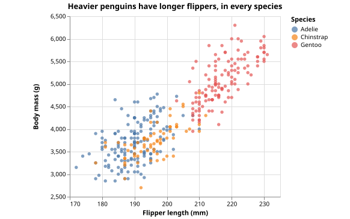
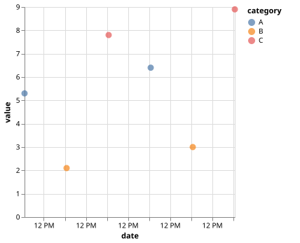
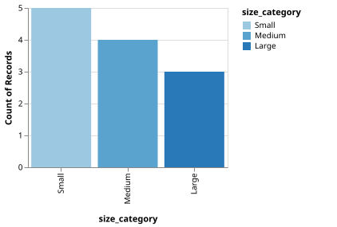
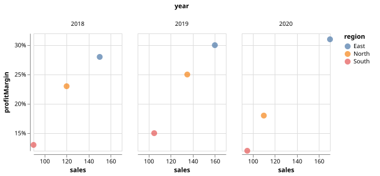
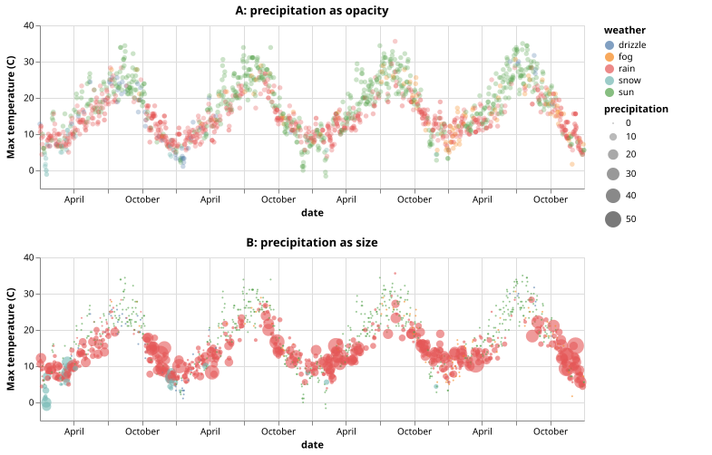
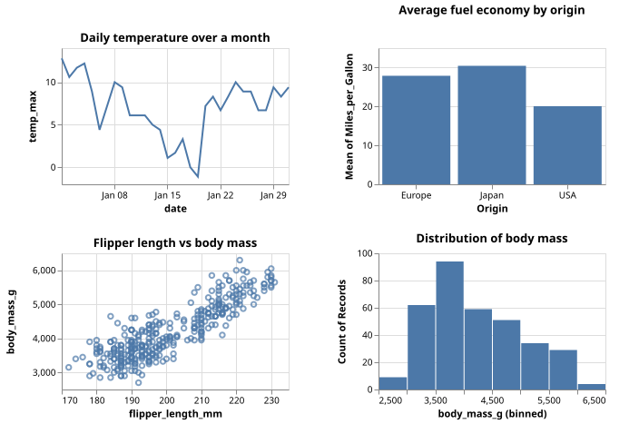
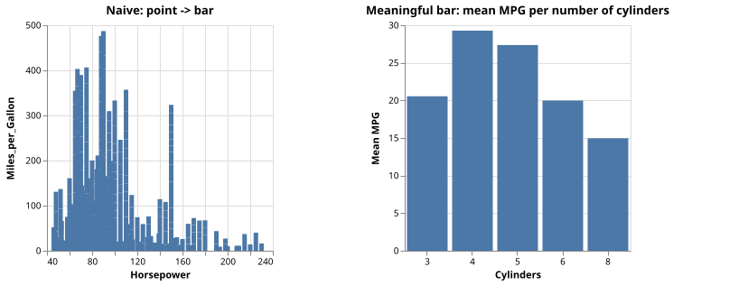
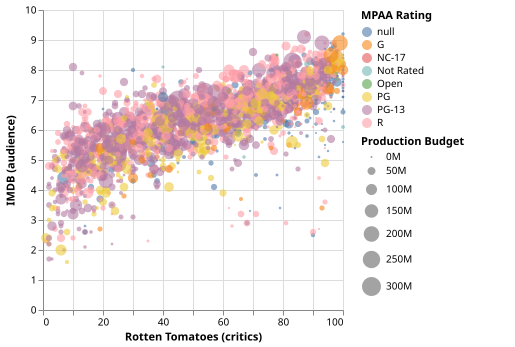
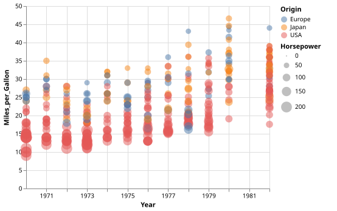
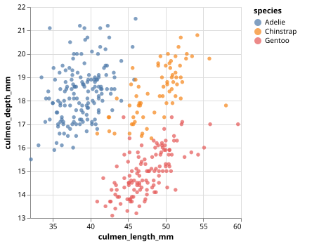

# Exercises

> Setup, runner commands and how to keep your own exercises in `workspace/`:
> see [README.md](README.md).

| ID | Title | Topic |
|---|---|---|
| [E04-01](#e04-01---penguins-warm-up) | Penguins warm-up | design |
| [E05-01](#e05-01---field-types) | Field types | types |
| [E05-02](#e05-02---nominal-or-ordinal) | Nominal or ordinal? | types, sort |
| [E05-03](#e05-03---channel-choice) | Channel choice | channels |
| [E05-04](#e05-04---weather-channels) | Weather channels | channels |
| [E05-05](#e05-05---mark-matching) | Mark matching | marks |
| [E05-06](#e05-06---change-the-mark) | Change the mark | marks |
| [E05-07](#e05-07---free-design) | Free design | all |
| [E05-F1](#e05-f1---fix-the-types) | Fix the types | types |
| [E05-F2](#e05-f2---fix-the-field-names) | Fix the field names | debugging |

---

## P04 - Grammar of Graphics and visualization frameworks

### E04-01 - Penguins warm-up

**Goal.** Design a static visualization (a single image) that answers one question about the penguins.

1. Write the question you want to answer.
2. On paper, fill this plan: `question | fields -> types -> channels | mark | transformations`.
3. Sketch the chart. No code yet.

**Check yourself.**
- Can a reader get the answer without your explanation (title, axis labels)?
- What did you do with the penguins that have missing values?

---

## P05 - Vega-Lite: Data, encoding, and marks

### E05-01 - Field types

**Goal.** Identify the type of each field and write a minimal encoding.

1. For `category`, `value`, `date` and `rank` write the Vega-Lite type and one sentence of justification.
2. Encode a scatter plot: `date` on x, `value` on y, `category` as color.
3. Show `rank` in a tooltip with the correct type.

**Check yourself.**
- `rank` is a number. Why is it not quantitative?
- What would change if you typed `date` as `nominal`?

### E05-02 - Nominal or ordinal?

**Goal.** See the practical consequences of the nominal/ordinal choice.

1. Run the template: in which order do the bars appear?
2. Change `type` to `ordinal` only. Did the order change? What changed?
3. Make the order Small, Medium, Large with `sort`.
4. Also color the bars by `size_category`: which type gives a more appropriate color scale, and why?

**Check yourself.** Which of the two changes (type or sort) fixed the order?

### E05-03 - Channel choice

**Goal.** Match fields to channels according to their type.

1. A scatter plot of `sales` (x) and `profitMargin` (y), colored by `region`. Format `profitMargin` as a percentage.
2. Where does `year` go? Try at least two channels (for example `color`, `size`, `column`) and keep the one that reads best.

**Check yourself.**
- Why is `year` typed ordinal (or temporal) and not quantitative here?
- Which channels did you reject, and why?

### E05-04 - Weather channels

**Goal.** Encode several fields in one chart and compare channels.

1. Plot the maximum temperature (`temp_max`) over time. Color by `weather`.
2. Encode `precipitation` with `opacity`.
3. Replace opacity with `size`. Which one lets you compare precipitation values better?

**Check yourself.** Rank position, size, color hue and opacity for quantitative data: where does opacity end up?

### E05-05 - Mark matching

**Goal.** Choose the mark that fits the data and the question.

1. Change the `mark` of each of the four views (all start as `point`).
2. Write one sentence per view: what makes that mark the right one?
3. For the histogram view, name two other marks that can show a distribution.

**Check yourself.** Which view gets worse if you use `bar`? Which one if you use `line`?

### E05-06 - Change the mark

**Goal.** Understand that a mark carries meaning.

1. Change `point` to `bar`. What does each bar represent now? Is the chart readable?
2. Try `tick`, `circle` and `square`.
3. Keep `bar`, but change the encoding so the chart is meaningful for these data.

**Check yourself.** Why does a bar chart need a zero baseline and a discrete (or binned) axis?

### E05-07 - Free design

**Goal.** Free design with explicit requirements.

- Choose a dataset and write the question your chart answers.
- Use an appropriate mark, at least three encoding channels and the right type for every field.
- Add a `title`, and a `description` that states the plan.
- Optional: one more dimension with `facet` or `shape`.

**Check yourself.** Could a classmate tell the question from the chart alone?

### E05-F1 - Fix the types

**Goal.** Diagnose wrong data types from the visual symptoms.

1. The chart renders, but there are **two type errors**. Write what you see (axis labels, legend) and the wrong type behind each symptom.
2. Fix them.

**Check yourself.** Why does Vega-Lite not warn you about the `ordinal` date?

### E05-F2 - Fix the field names

**Goal.** Debug a chart that is silently empty.

1. The template shows nothing and reports no error. Open the data and compare with the spec: list **three** problems.
2. Fix them.

**Check yourself.** Why is a wrong field name not an error in Vega-Lite? Where would you look first next time?

---