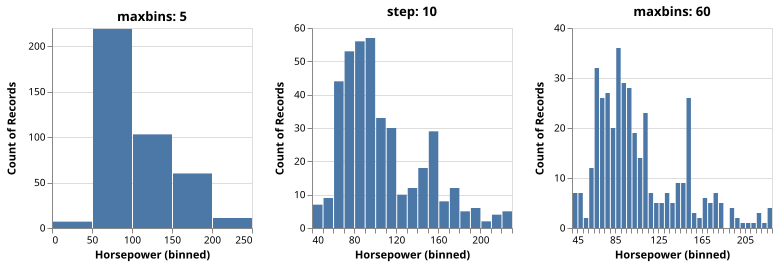
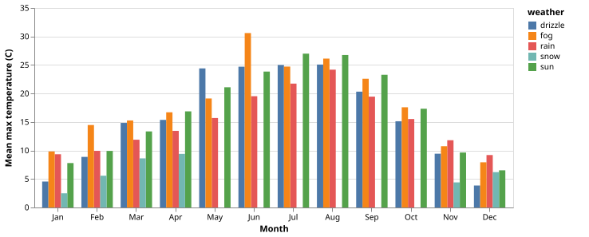
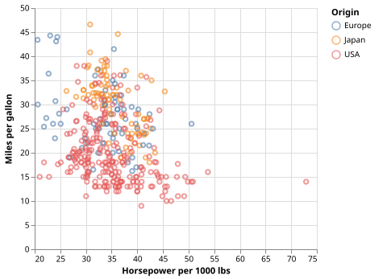
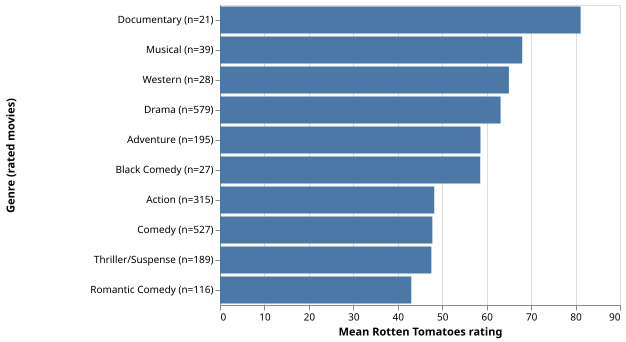
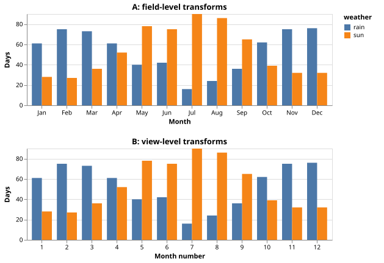
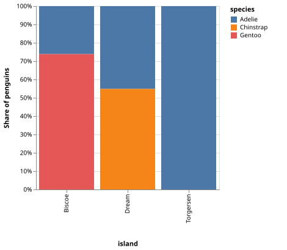
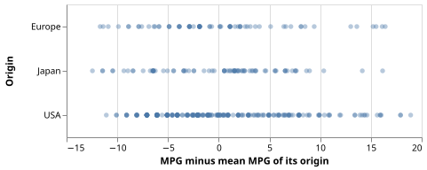
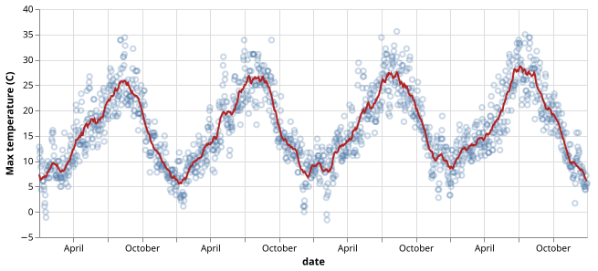
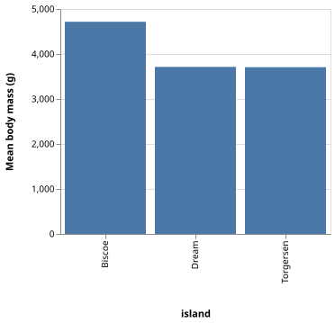
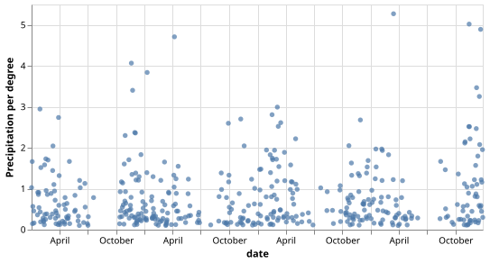

# Exercises

> Setup, runner commands and how to keep your own exercises in `workspace/`:
> see [README.md](README.md).

| ID | Title | Topic |
|---|---|---|
| [E04-01](#e04-01---penguins-warm-up) | Penguins warm-up | design |
| [E05-01](#e05-01---field-types) | Field types | types |
| [E05-02](#e05-02---nominal-or-ordinal) | Nominal or ordinal? | types, sort |
| [E05-03](#e05-03---channel-choice) | Channel choice | channels |
| [E05-04](#e05-04---weather-channels) | Weather channels | channels |
| [E05-05](#e05-05---mark-matching) | Mark matching | marks |
| [E05-06](#e05-06---change-the-mark) | Change the mark | marks |
| [E05-07](#e05-07---free-design) | Free design | all |
| [E05-F1](#e05-f1---fix-the-types) | Fix the types | types |
| [E05-F2](#e05-f2---fix-the-field-names) | Fix the field names | debugging |
| [E06-01](#e06-01---histogram-bins) | Histogram bins | bin |
| [E06-02](#e06-02---temporal-aggregation) | Temporal aggregation | timeUnit, aggregate |
| [E06-03](#e06-03---derived-field) | Derived field | calculate, filter |
| [E06-04](#e06-04---top-n-ranking) | Top-N ranking | window, filter |
| [E06-05](#e06-05---two-ways) | Two ways | field vs view level |
| [E06-06](#e06-06---stack-and-sort) | Stack and sort | stack, sort |
| [E06-07](#e06-07---join-aggregate) | Join aggregate | joinaggregate |
| [E06-08](#e06-08---moving-average) | Moving average | window |
| [E06-F1](#e06-f1---fix-the-aggregate) | Fix the aggregate | schema errors, sort |
| [E06-F2](#e06-f2---fix-the-empty-chart) | Fix the empty chart | transform order |

---

## P04 - Grammar of Graphics and visualization frameworks

### E04-01 - Penguins warm-up

**Goal.** Design a static visualization (a single image) that answers one question about the penguins.

1. Write the question you want to answer.
2. On paper, fill this plan: `question | fields -> types -> channels | mark | transformations`.
3. Sketch the chart. No code yet.

**Check yourself.**
- Can a reader get the answer without your explanation (title, axis labels)?
- What did you do with the penguins that have missing values?

---

## P05 - Vega-Lite: Data, encoding, and marks

### E05-01 - Field types

**Goal.** Identify the type of each field and write a minimal encoding.

1. For `category`, `value`, `date` and `rank` write the Vega-Lite type and one sentence of justification.
2. Encode a scatter plot: `date` on x, `value` on y, `category` as color.
3. Show `rank` in a tooltip with the correct type.

**Check yourself.**
- `rank` is a number. Why is it not quantitative?
- What would change if you typed `date` as `nominal`?

### E05-02 - Nominal or ordinal?

**Goal.** See the practical consequences of the nominal/ordinal choice.

1. Run the template: in which order do the bars appear?
2. Change `type` to `ordinal` only. Did the order change? What changed?
3. Make the order Small, Medium, Large with `sort`.
4. Also color the bars by `size_category`: which type gives a more appropriate color scale, and why?

**Check yourself.** Which of the two changes (type or sort) fixed the order?

### E05-03 - Channel choice

**Goal.** Match fields to channels according to their type.

1. A scatter plot of `sales` (x) and `profitMargin` (y), colored by `region`. Format `profitMargin` as a percentage.
2. Where does `year` go? Try at least two channels (for example `color`, `size`, `column`) and keep the one that reads best.

**Check yourself.**
- Why is `year` typed ordinal (or temporal) and not quantitative here?
- Which channels did you reject, and why?

### E05-04 - Weather channels

**Goal.** Encode several fields in one chart and compare channels.

1. Plot the maximum temperature (`temp_max`) over time. Color by `weather`.
2. Encode `precipitation` with `opacity`.
3. Replace opacity with `size`. Which one lets you compare precipitation values better?

**Check yourself.** Rank position, size, color hue and opacity for quantitative data: where does opacity end up?

### E05-05 - Mark matching

**Goal.** Choose the mark that fits the data and the question.

1. Change the `mark` of each of the four views (all start as `point`).
2. Write one sentence per view: what makes that mark the right one?
3. For the histogram view, name two other marks that can show a distribution.

**Check yourself.** Which view gets worse if you use `bar`? Which one if you use `line`?

### E05-06 - Change the mark

**Goal.** Understand that a mark carries meaning.

1. Change `point` to `bar`. What does each bar represent now? Is the chart readable?
2. Try `tick`, `circle` and `square`.
3. Keep `bar`, but change the encoding so the chart is meaningful for these data.

**Check yourself.** Why does a bar chart need a zero baseline and a discrete (or binned) axis?

### E05-07 - Free design

**Goal.** Free design with explicit requirements.

- Choose a dataset and write the question your chart answers.
- Use an appropriate mark, at least three encoding channels and the right type for every field.
- Add a `title`, and a `description` that states the plan.
- Optional: one more dimension with `facet` or `shape`.

**Check yourself.** Could a classmate tell the question from the chart alone?

### E05-F1 - Fix the types

**Goal.** Diagnose wrong data types from the visual symptoms.

1. The chart renders, but there are **two type errors**. Write what you see (axis labels, legend) and the wrong type behind each symptom.
2. Fix them.

**Check yourself.** Why does Vega-Lite not warn you about the `ordinal` date?

### E05-F2 - Fix the field names

**Goal.** Debug a chart that is silently empty.

1. The template shows nothing and reports no error. Open the data and compare with the spec: list **three** problems.
2. Fix them.

**Check yourself.** Why is a wrong field name not an error in Vega-Lite? Where would you look first next time?

---

# P06 - Data transformation

## E06-01 - Histogram bins

**Goal.** Build a histogram and see the effect of the bin size.

1. The template counts cars per distinct Horsepower value. Add `bin` to get a histogram.
2. Compare at least three settings (`maxbins`, `step`) side by side (`hconcat`).
3. Which setting shows the shape of the distribution best?

**Check yourself.** What are the symptoms of too few and too many bins?

## E06-02 - Temporal aggregation

**Goal.** Mean maximum temperature (`temp_max`) of each month, for each weather type.

1. `x` = month (`timeUnit`), `y` = mean `temp_max`, `color` = `weather`.
2. Look at the stacked bars: why are they misleading?
3. Fix it with `xOffset` (grouped bars).

**Check yourself.**
- What does stacking a mean mean?
- `timeUnit: month` pools the four years. Is that what you want?

## E06-03 - Derived field

**Goal.** Power-to-weight ratio against fuel economy.

1. Add a `calculate` transform: horsepower per 1000 lbs, named with `as`.
2. Some cars have no Horsepower: handle them explicitly.
3. Plot the ratio (x) against `Miles_per_Gallon` (y).

**Check yourself.** Why put `filter` before `calculate`? What happens to `null / number` in a calculation?

## E06-04 - Top-N ranking

**Goal.** Bar chart of the mean Rotten Tomatoes rating of the top 10 genres, in descending order.

1. Remove movies without a genre.
2. Keep only genres with at least 20 rated movies.
3. Rank the genres and keep the top 10 (`window` with `rank`).
4. Show the number of rated movies in the axis label.

**Check yourself.** Which genre disappears after step 2, and why is including it a bad ranking?

## E06-05 - Two ways

**Goal.** Number of rainy and sunny days per month, built in two ways that must give the same numbers.

- **A** - field-level transforms (`timeUnit` and `aggregate` inside the encoding).
- **B** - view-level transforms (`calculate` and `aggregate` in `transform`).

**Check yourself.** Which version is easier to read? Which one would you need if you had to filter on the aggregated value?

## E06-06 - Stack and sort

**Goal.** Species composition of each island as 100% stacked bars, islands sorted by size.

1. `stack: normalize`.
2. Sort the islands by the number of penguins.

**Check yourself.** What is the difference between `sort: "descending"` and `sort: "-y"`? Which question does a normalized stack answer, and which one does it hide?

## E06-07 - Join aggregate

**Goal.** How far is each car from the average of its origin?

1. Add the mean MPG of the origin to each row (`joinaggregate`).
2. Compute the difference (`calculate`).
3. Plot one strip per origin.

**Check yourself.** How is `joinaggregate` different from `aggregate`? How many rows do you have after each?

## E06-08 - Moving average

**Goal.** Reveal the seasonal trend under the noisy daily values.

1. Turn the spec into two layers: the points and a line.
2. The line is the 31-day moving average (`window` transform, `frame: [-15, 15]`).

**Check yourself.** Why does `window` need `sort`? What happens at the first and last 15 days?

## E06-F1 - Fix the aggregate

**Goal.** Read a schema error and fix a chart that is wrong even after it renders.

1. The Vega Editor reports an error. Write what it says and what it means.
2. Fix it. The chart should show mean body mass per island, from heaviest to lightest: is the order right?

**Check yourself.** What does `"sort": "descending"` actually sort?

## E06-F2 - Fix the empty chart

**Goal.** Debug a transform pipeline step by step.

1. The chart is empty. Comment out the `transform` entries one by one from the bottom: when does data appear?
2. Fix **two** problems.

**Check yourself.** What is the value of a field that does not exist yet, and how does a comparison with it evaluate?

---
